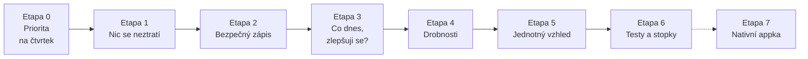

# Workout deník – plán vývoje

*Převedeno z dokumentu na claude.ai 23. 9. 2026 při přechodu na PWA + GitHub.*

## Jak s plánem pracovat

Jedna session v Claude Code = jedna úloha z plánu, označená ID (např. F1-01). Tento soubor je jediný zdroj pravdy o tom, co je hotové a co je na řadě. Hotové úlohy jsou tu jen jedním řádkem, celé popisy a vyřešené otázky jsou v [hotovo.md](hotovo.md), log v [log.md](log.md).

1. V Claude Code otevři repo a napiš ID úlohy, např. „Udělej F0-02 z docs/plan-vyvoje.md".
2. Claude nejdřív popíše, jak bude funkce fungovat a co se změní, výhody, nevýhody a dopady na další vývoj, a položí doplňující otázky. Implementovat začne až na výslovný pokyn.
3. Claude udělá změny ve vlastní větvi a otevře pull request.
4. Otestuješ v telefonu, dáš Merge.
5. Claude v rámci téhož PR zaškrtne úlohu (zkrátí ji na jeden řádek, celý popis přesune do `hotovo.md`) a přidá řádek do `log.md`.

Pravidla pro každou úpravu:

- Jedna úloha = jedna větev = jeden pull request.
- Stará data se nesmí ztratit: nová pole mají výchozí hodnoty, uložená data se při načtení automaticky doplní.
- Před větší změnou si v appce udělat zálohu dat.
- Jen zdarma: offline, bez serveru, bez placených API a knihoven. Kód na GitHubu, hosting na GitHub Pages, data jen v telefonu.

## Kontext appky

Workout deník je osobní HTML appka (PWA) pro zápis tréninků ve fitku na Androidu, inspirovaná Hevy. Historie je importovaná z CSV exportu Hevy.

Data jsou uložená v telefonu (IndexedDB). Záloha mimo telefon řeší F0-01 (export JSON, sdílení na Disk / e-mail).

Klíčové specifikum: cvičím ve **více fitkách** a stejný stroj má v každém jiný odpor. Statistiky, grafy a předvyplňování hodnot proto musí jít oddělit podle fitka.

Původní zadání:

- Progres cviků, rozlišení warm-up a pracovních sérií, statistiky s volbou období (týden, měsíc, 3/6 měsíců, rok, vše).
- Databáze cviků s popisem nebo obrázkem, doplněná z Hevy, česko-anglické názvy.
- Šablony tréninků, vytvoření šablony z odcvičeného tréninku.
- Odpočinkový časovač se zvukem a ±15 s.
- Tělesná měření (váha, % svalů, % tuku).

## Priority a pořadí

Pořadí: nejdřív ochrana dat, pak pohodlí při samotném tréninku, pak šablony, statistiky, chytré funkce a nakonec motivace. Fáze třídí úlohy podle témat; kdy se která úloha dělá, určují etapy níže.

### Etapy podle naléhavosti

Aktuální pořadí dalších úloh (zhodnoceno 27. 9. 2026 podle nezávislého UX auditu, má přednost před pořadím ve fázích). Úlohy jsou rozdělené do etap podle naléhavosti. V etapě se dělají shora dolů; úlohy, které na sobě nezávisí, jdou dělat souběžně (každá ve své větvi). Fáze níže zůstávají tématické (kam úloha patří), etapy říkají, kdy se dělá.

Značky u úloh z auditu (celý audit a přiřazení všech nálezů k úlohám v `docs/navrhy/ux-audit-2026-09-27.md`):

- **P1–P3** naléhavost: P1 výrazně zhoršuje zápis tréninku nebo tiše ztrácí data, P2 zhoršuje používání, P3 drobnost. (P0 = nejde používat nebo se ztrácí data; audit žádné nenašel.)
- **A–D** druh nálezu: A objektivní problém, B silné doporučení, C vkus, D rozhodnutí vlastníka (u takových úloh je otázka v části Otevřené otázky).
- Náročnost: velmi nízká / nízká (hodiny) / střední.

#### Etapa 0 – Priorita uživatele (zapsáno 30. 9. 2026, začít ve čtvrtek 1. 10. 2026)

Šest změn z používání, mají přednost před etapami 1–6. Každá úloha = vlastní větev a PR; před implementací podle pravidla v `CLAUDE.md` nejdřív popis a otázky (návrhy výchozích voleb v Otevřených otázkách). Doporučené pořadí (F2-11 a F1-19 se dotýkají stejného kódu předvyplnění `exHints`, proto za sebou, ne souběžně):

- ~~**F2-10** Poznámka ke cviku v šabloně a z historie~~ – hotovo 30. 9. 2026.
- ~~**F1-19** Minule jako text u cviku místo sloupce~~ – hotovo 30. 9. 2026.
- ~~**F2-11** Předvyplnění ze šablony a z historie místo minula~~ – hotovo 7. 10. 2026.
- ~~**F3-31** Vázáno na fitko jen ve formuláři Upravit cvik~~ – hotovo 8. 10. 2026.
- ~~**F2-12** Skrýt nepoužívanou šablonu~~ – hotovo 8. 10. 2026.
- ~~**F3-30** Nový cvik kopií jiného cviku~~ – hotovo 7. 10. 2026.
- ~~**F3-32** Smazat vlastní cvik~~ – hotovo 8. 10. 2026.
- ~~**F3-42** Grafy cviku: objem série, opakování celkem~~ – hotovo 13. 10. 2026.
- ~~**F4-14** Oprava: Bez zlepšení u cviku na čas se zátěží~~ – hotovo 13. 10. 2026.
- ~~**F3-43** Jednotné svislé mezery a jejich kontrola~~ – hotovo 13. 10. 2026.
- ~~**F3-44** Mezery uvnitř karet a panelů~~ – hotovo 14. 10. 2026.
- ~~**F3-47** Zbylé ruční mezery mimo karty~~ – hotovo 14. 10. 2026.

#### Etapa 1 – Nic se neztratí, zápis bez zbytečných klepnutí (P1, rychlé)

1. ~~**F1-14** Neoznačené série s hodnotami při dokončení~~ – hotovo 27. 9. 2026.
2. ~~**F1-13** Předvyplnění ze série nad~~ – hotovo 27. 9. 2026.
3. ~~**F0-13** Záloha častěji a ze souhrnu~~ – hotovo 27. 9. 2026.

#### Etapa 2 – Bezpečnější ovládání při tréninku (P2, rychlé)

4. ~~**F1-15** Druh série výběrem místo cyklu~~ – odloženo 28. 9. 2026 (uživatel se nikdy neuklikl), viz `docs/navrhy/F1-15-druh-serie.md`.
5. ~~**F1-18** Větší dotykové plochy v tréninku~~ – hotovo 28. 9. 2026.
6. ~~**F1-16** Pruh pauzy nezakrývá obsah~~ – hotovo 9. 10. 2026.
7. ~~**F1-06** Přidávání cviku a hledání po slovech~~ – hotovo 9. 10. 2026.

#### Etapa 3 – „Co dnes?“ a „Zlepšuji se?“ (P2, větší úpravy)

8. ~~**F2-04** Šablona na řadě jako hlavní akce úvodu~~ – zrušeno 14. 10. 2026 (stačí plánované tréninky v kalendáři, F4-07).
9. ~~**F3-26** Progres po cvicích ve Statistikách~~ – hotovo 9. 10. 2026.
10. ~~**F3-25** Rekord jako skutečná událost~~ – hotovo 10. 10. 2026.
11. ~~**F3-27** Porovnání s předchozím obdobím~~ – hotovo 10. 10. 2026.

#### Etapa 4 – Drobnosti a doladění (P3, rychlé)

12. ~~**F3-24** Texty a drobnosti z auditu~~ – hotovo 10. 10. 2026.
13. ~~**F1-17** Kratší pauza po zahřívací sérii~~ – zamítnuto 10. 10. 2026, obnoveno jako F1-22 (hotovo 13. 10. 2026).
14. ~~**F3-28** Stránka cviku: záložka Historie~~ – hotovo 10. 10. 2026.
15. ~~**F3-29** Formulář měření jen s používanými údaji~~ – zrušeno 14. 10. 2026 (měření doplní F4-13 a F6-04).

#### Etapa 5 – Jednotný vzhled

16. ~~**F3-23** Jednotný vzhled v úzkém rozsahu~~ – hotovo 10. 10. 2026.

#### Etapa 6 – Před nativní appkou (zhodnoceno 14. 10. 2026)

17. ~~**F3-33** Výška v Nastavení a BMI z hmotnosti~~ – hotovo 10. 10. 2026.
18. ~~**F1-07** Nastavení stroje podle fitka~~ – hotovo 11. 10. 2026.
19. ~~**F0-17** Automatické testy (kouřový test, záloha tam a zpět)~~ – hotovo 14. 10. 2026.
20. ~~**F3-16** Rozepsaný formulář přežije zavření appky~~ – hotovo 13. 10. 2026.
21. ~~**F1-24** Stopky u série na čas~~ – hotovo 14. 10. 2026.
22. Bez priority (užitek zatím nejasný, rozhodne uživatel): F1-12, F1-20, F3-15, F4-09, F4-11, F5-04, F5-05, F5-08, F5-09.

#### Etapa 7 – Nativní appka (zapsáno 13. 10. 2026)

Kdy začít, určí uživatel; úlohy jdou jen v tomto pořadí (každá stojí na předchozí). Popis a rozhodnutí ve Fázi 6. Před F6-01 je hotová F0-17 (testy). F5-02 nezávisí na nativní appce, doporučené místo je za F6-03.

23. **F6-01** Nativní obal (Capacitor), APK z GitHub Actions.
24. **F6-02** Spolehlivý konec pauzy (i se zamčeným displejem a na hodinkách).
25. **F6-03** Záloha se zálohou telefonu (Google One).
26. **F5-02** Týdenní cíl (zkusit, uživatel si není jistý přínosem).
27. **F6-04** Složení těla ze Samsung Health do Těla.
28. **F6-05** Tep z hodinek k tréninku (až po F6-04).

Zrušené 14. 10. 2026 (popisy v `hotovo.md`, sekce Zrušené úlohy): F2-04, F3-04, F3-05, F3-29, F3-48, F4-03, F4-10, F5-01, F5-03, F5-06, F5-07. Odložené: F0-11 (podmínky u úlohy), F0-16, F1-15, F3-07, F4-02. Nahrazené: F0-14 (F6-03).

#### Ověřit při používání (souběžně s etapou 1)

Audit testoval v prohlížeči v režimu telefonu, ne v telefonu. Tohle rozhodne jen skutečné používání, nejlépe týden tréninků s poznámkami. Výsledek může změnit pořadí nebo zadání uvedených úloh.

- Jak často cvičíš cvik, který v daném fitku nemá historii (přínos F1-13).
- Chodí oznámení a vibrace konce pauzy se zhasnutým displejem a appkou na pozadí? (F1-04; Android uspává časovače.)
- Gboard po Napsat: nezakryje klávesnice řádek? (Přechod klávesou Další z kg na Opak. vyřešila F3-24.)
- Prediktivní gesto Zpět (Android 14+) v nainstalované appce (F0-06).
- Čitelnost šedého předvyplnění na slunci a v ostře osvětlené posilovně ve světlém motivu (F3-01, F3-23).
- Vadí 6 záložek ve spodní liště? (Odloženo, viz Co neděláme.)
- Velikost dat v `localStorage`: `zd1:cache` drží celou knihovnu cviků i všechny tréninky a limit cca 5 MB sdílí vydaná appka i testovací verze. Časem zkontrolovat; když poroste k limitu, cache zmenšit (např. bez výchozích cviků z `EX_DB`). Databáze pro online hledání (`js/fedb.js`) se už teď načítá až při hledání.

### Převod na PWA

- [x] **PWA-01** Převod z artefaktu na PWA na GitHub Pages

### Fáze 0 – Data a základ

Bez zálohy hrozí ztráta celé historie a bez svalových partií u cviků nejdou udělat statistiky ve fázi 3.

- [x] **F0-01** Záloha jedním klepnutím (export a import JSON, body obnovy, připomínka)
- [x] **F0-02** Databáze cviků se svalovými partiemi
- [x] **F0-03** Přidání cviku z online databáze free-exercise-db
- [x] **F0-04** Verze appky v Nastavení, testovací verze PR
- [x] **F0-05** Záložka Cviky
- [x] **F0-06** Systémové tlačítko Zpět
- [x] **F0-07** Pořadí fitek, uložená barva fitka
- [x] **F0-08** Pravidla zabezpečení (Content-Security-Policy)
- [x] **F0-09** Odkaz u cviku jen http(s)
- [x] **F0-10** Čitelný kód (přeformátování)
- [ ] **F0-11** Rozdělit `js/app.js` do víc souborů podle částí (např. datová vrstva a záloha, rozdělaný trénink a pauza, historie s kalendářem a souhrnem, statistiky, záložka Cviky, nastavení; v `app.js` zůstane start, vykreslení a akce). Bez build kroku: víc `<script>` v `index.html` ve správném pořadí a všechny soubory do `FILES` v `sw.js`. **Odloženo 27. 9. 2026 (u F0-12):** přínos pro spotřebu tokenů je po F0-12 střední (sekce mají popis a ID v nadpisu, čte se jen potřebná část), riziko je jisté (dnes je vše v jedné funkci, po rozdělení by jména sdílely všechny soubory a mohla by se srazit s vestavěnými jmény prohlížeče; přerušená historie řádků; obrovské konflikty s otevřenými PR). **Kdy se vrátit (upraveno 14. 10. 2026, místo hranice 18 000 řádků, kterou `app.js` překročil):** nutné podmínky jsou automatické testy (F0-17, hotové 14. 10. 2026) a žádný otevřený PR; spouštěč je, že se souběžné větve v `app.js` opakovaně přetahují o stejná místa, nebo že F6-01 bude potřebovat oddělit nativní část. Počet řádků sám o sobě důvod není.
- [x] **F0-12** Úklid repa pro menší spotřebu tokenů (kratší `CLAUDE.md`, rozdělený plán, `.ignore`, smazaná `puvodni/`)
- [x] **F0-13** Záloha častěji a ze souhrnu
- [ ] ~~**F0-14** Automatická záloha na Google Disk~~ – **nahrazeno 13. 10. 2026 úlohou F6-03** (záloha se zálohou telefonu v nativní appce, bez přihlašování a Google Cloud projektu). Vrátit se jen, kdyby se od nativní appky upustilo. Původní rozbor: (nápad 27. 9. 2026 u F0-13; D · střední; **nejdřív zkouška**): appka po uložení tréninku sama nahraje zálohu do skryté složky „data aplikace“ na Disku uživatele (Drive API, `appDataFolder`, oprávnění `drive.appdata`, vidí ji jen tahle appka), drží posledních pár záloh a na novém telefonu po přihlášení nabídne obnovu. Zdarma, ale uživatel jednou založí projekt v Google Cloud (OAuth klient, stav Testing, Google ukáže varování „Aplikace není ověřená“). Přihlášení bez cizích skriptů: okno `accounts.google.com` (token na 1 hodinu) a malá stránka pro návrat ve stejné doméně. Na pozadí to nejde: přístup vyprší po hodině a obnoví se jen po klepnutí (nejlépe navázat na Dokončit v souhrnu, okno Googlu jen problikne). Mění pravidla: řádek o cloudu v Co neděláme, CSP (`connect-src https://www.googleapis.com`), testovací verze musí zálohovat odděleně od vydané. Zkouška: funguje okno přihlášení a návrat do nainstalované appky na Androidu? Alternativa bez programování: aplikace typu Autosync nebo FolderSync, která sama nahrává složku Stažené na Disk (cizí aplikace, zdarma s omezeními). OneDrive přímo z appky nedoporučeno (registrace aplikace u Microsoftu je pro osobní účet složitější, OneDrive pokryje sdílení z F0-13). Záloha telefonu do Googlu (Google One) data webové appky nezahrne (jsou uvnitř Chromu, ten data webů nezálohuje). Zvážit menší zálohu: ZIP (fotky jako JPEG soubory místo base64, které je o třetinu větší; údaje o trénincích zkomprimované 5–10×) nebo `.json.gz`, obojí umí Chrome bez knihovny (`CompressionStream`). U sdílení (F0-13) to nejde, `.zip` ani `.gz` Chrome na Androidu sdílet nedovolí; nahrávání přes Drive API typ souboru neomezuje.
- [x] **F0-15** Čitelný soubor zálohy
- [ ] **F0-16** Hromadné a hromadné selektivní mazání záznamů (tréninků, měření) (přání uživatele 13. 10. 2026, **odloženo 14. 10. 2026**: pro jednoho uživatele malý přínos, nevratné mazání): dnes jde smazat jen jeden trénink nebo jedno měření. Rozhodnout: kde (Historie, Tělo, Nastavení → Data a záloha), jak vybírat (zaškrtávání v seznamu, filtr podle období, fitka, u měření podle zdroje: ruční / import ze Samsung Health F4-13 s `shId`), potvrzení s počtem a bod obnovy před smazáním (jako před obnovou ze zálohy).
- [x] **F0-17** Automatické testy (kouřový test, záloha tam a zpět, starší formát zálohy)
- [x] **F0-18** Pojistka dat vydané verze v testovacích verzích

### Fáze 1 – Ovládání při tréninku

Největší přínos při každém tréninku, většinou malé úpravy.

- [x] **F1-01** „Minule“ u každé série, předvyplnění
- [x] **F1-02** Displej nezhasne během pauzy (Wake Lock)
- [x] **F1-03** Krokovač +/− pro váhu a opakování
- [x] **F1-04** Časovač pauzy z času konce, vibrace, oznámení
- [x] **F1-05** Pokračování rozdělaného tréninku po zavření prohlížeče
- [x] **F1-06** Přidávání cviku a hledání po slovech
- [x] **F1-07** Nastavení stroje podle fitka
- [x] **F1-08** Zahřívací série „60 %“ z minula
- [x] **F1-09** Délka pauzy podle cviku
- [x] **F1-10** Kontrola čísel, upozornění na velký skok
- [ ] **F1-12** Ruční spuštění pauzy (nápad, rozhodnout později; vzniklo u F4-05): s vypnutým časovačem pauzy (hlavní vypínač v Nastavení → Odpočinek) jít pauzu spustit ručně, např. klepnutím na čas tréninku nahoře.
- [x] **F1-11** Opravy z používání při tréninku (návrat na naposledy změněný cvik…)
- [x] **F1-13** Předvyplnění ze série nad
- [x] **F1-14** Neoznačené série s hodnotami při dokončení
- [ ] **F1-15** Druh série výběrem místo cyklu (UX audit 27. 9. 2026, §5 nález 2): klepnutí na číslo série by místo přepnutí dokola otevřelo panel se 4 druhy (jako v Hevy). **Odloženo 28. 9. 2026:** uživatel se nikdy neuklikl a zapsané hodnoty ani předvyplnění se přepnutím neztratí. Ověřené chování, podoba v Hevy a návrh v `docs/navrhy/F1-15-druh-serie.md`. Od F1-18 (28. 9.) reaguje odznak na klepnutí v celé buňce; kdyby se tím začal druh série měnit omylem, vrátit se k F1-15.
- [x] **F1-16** Pruh pauzy nezakrývá obsah
- [x] **F1-18** Větší dotykové plochy v tréninku
- [x] **F1-19** Minule jako text u cviku místo sloupce
- [x] **F1-21** Pauza cviku v šabloně
- [x] **F1-22** Pauza po zahřívací sérii
- [x] **F1-23** Rychlé přepisování čísel v sériích
- [ ] **F1-20** Kompaktní karta cviku po první sérii (nápad 11. 10. 2026 u F1-07, odloženo, dokud karta neruší): dokud cvik nemá hotovou sérii, jsou pod názvem vidět všechny řádky (stroj, poznámka, Minule, návrh, stagnace); po první ✓ zůstane Minule a stroj s poznámkou se zmenší na jeden řádek, který jde rozbalit (jako Minule). Nejdřív náhled. Zamítnuto místo toho: tlačítko (i) s kartou všech informací (víc klepnutí mezi sériemi, připomínky by se přehlédly, třetí cesta k informacím o cviku vedle názvu a grafu).
- [x] **F1-24** Stopky u série na čas
- [x] **F1-25** Přepisování čísel ve formulářích

### Fáze 2 – Šablony a historie

- [x] **F2-01** Cvičit znovu z historie
- [x] **F2-02** Šablony podle fitka
- [x] **F2-03** Smazání série tahem, Vrátit cvik
- [ ] ~~**F2-04** Šablona na řadě jako hlavní akce úvodu~~ – zrušeno 14. 10. 2026.
- [x] **F2-05** Vlastní fotky u cviku
- [x] **F2-08** Jedinečné názvy šablon
- [x] **F2-06** Archivace a smazání fitka
- [x] **F2-09** Úvodní obrazovka během tréninku
- [x] **F2-07** Pořadí přetažením prstu
- [x] **F2-10** Poznámka ke cviku v šabloně a z historie
- [x] **F2-11** Předvyplnění ze šablony a z historie místo z minula
- [x] **F2-12** Skrýt nepoužívanou šablonu
- [x] **F2-13** Karta šablony: klepnutí = Začít, ⋯ = možnosti
- [x] **F2-14** Pauza cviku v úpravě šablony

### Fáze 3 – Statistiky a vzhled

Předpoklad: F0-02 (svalové partie).

- [x] **F3-01** Barvy fitek a partií, tmavý režim
- [x] **F3-02** Osobní rekordy s oslavou
- [x] **F3-03** Souhrn po tréninku
- [ ] ~~**F3-04** Radar svalových partií ve statistikách~~ – zrušeno 14. 10. 2026.
- [ ] ~~**F3-05** Radar v souhrnu po tréninku~~ – zrušeno 14. 10. 2026.
- [x] **F3-06** Kalendář
- [ ] **F3-07** Roční heatmapa tréninků (barva podle počtu sérií). **Odloženo 24. 9. 2026:** po náhledech samoúčelná, co a kdy se cvičilo ukazuje kalendář (F3-06) a graf Průběh. Celá diskuse, rozhodnutí, náhledy a odkaz na hotový kód v `docs/navrhy/F3-07-heatmapa.md`.
- [x] **F3-08** Jednotky v grafech
- [x] **F3-09** Nastavení jako rozcestník
- [x] **F3-10** Oprava: Statistiky cviku na čas a vzdálenost
- [x] **F3-11** Jednotná stupnice písma, volba Velikost písma
- [x] **F3-12** Tlačítko Dokončit v souhrnu
- [x] **F3-13** Statistiky rozdělené na části
- [x] **F3-14** Nový / Upravit cvik jako stránka
- [ ] **F3-15** Zajímavosti ve Statistikách (nápad 25. 9. 2026, nic nerozhodnuto): kromě grafů a porovnání vtipné nebo unikátní údaje z vlastních dat. Rekordní dny (největší objem, nejdelší trénink, nejvíc sérií, nejintenzivnější trénink v kg/min; klepnutí otevře souhrn tréninku), zvyky (ranní ptáče / noční sova, oblíbený den v týdnu, nejdelší mezera bez tréninku, index vynechaných nohou, sváteční trénink), kuriozity (nejdelší pauza mezi sériemi, nejčastější počet opakování) a obrazná srovnání (F5-07). Vše se počítá z uložených tréninků, nic se neukládá. Návrh: čtvrtá část „Zajímavosti“ ve Statistikách (F3-13), platí filtr fitka a období. Celý seznam nápadů, souvislosti a otevřené otázky v `docs/navrhy/F3-15-zajimavosti.md`.
- [x] **F3-16** Rozepsaný formulář přežije zavření appky
- [x] **F3-17** Jedinečné názvy cviků
- [x] **F3-18** Výběr cviků stejný jako záložka Cviky
- [x] **F3-19** Uložený trénink jako stránka
- [x] **F3-20** Vlastní ikony místo emoji
- [x] **F3-21** Kratší nápovědy (otazník v nadpisu sekce)
- [x] **F3-22** Karta cviku bez štítků
- [x] **F3-23** Jednotný vzhled v úzkém rozsahu
- [x] **F3-24** Texty a drobnosti z auditu
- [x] **F3-25** Rekord jako skutečná událost
- [x] **F3-26** Progres po cvicích ve Statistikách
- [x] **F3-27** Porovnání s předchozím obdobím
- [x] **F3-28** Stránka cviku: záložka Historie
- [ ] ~~**F3-29** Formulář měření jen s používanými údaji~~ – zrušeno 14. 10. 2026.
- [x] **F3-30** Nový cvik kopií jiného cviku
- [x] **F3-31** Vázáno na fitko jen ve formuláři Upravit cvik
- [x] **F3-32** Smazat vlastní cvik
- [x] **F3-33** Výška v Nastavení a BMI z hmotnosti
- [x] **F3-34** Statistiky cviku z tréninku: fitko tréninku a rozdělaný trénink
- [x] **F3-35** Odznak druhu série a velikost RIR/RPE
- [x] **F3-36** Zarovnání řádků sérií
- [x] **F3-37** Stránka tréninku: Poprvé a porovnání pod sériemi, český název
- [x] **F3-38** Série s jednotkou: 12×20kg
- [x] **F3-39** Políčko Opak. před kg
- [x] **F3-40** Formulář cviku po sekcích
- [x] **F3-41** Filtr partií v panelu
- [x] **F3-42** Grafy cviku: objem série, opakování celkem, max zátěž u cviku na čas
- [x] **F3-43** Jednotné svislé mezery a jejich kontrola
- [x] **F3-44** Mezery uvnitř karet a panelů
- [x] **F3-45** Jednotná typografie karet, seznamů a popisků
- [x] **F3-47** Zbylé ruční mezery mimo karty
- [x] **F3-46** Šipka u cviku ve výběru a panel Informace o cviku
- [ ] ~~**F3-48** Design manuál~~ – zrušeno 14. 10. 2026.
- [x] **F3-49** Z historie cviku na stránku tréninku
- [x] **F3-50** Přidání cviku z online databáze: šipka, fotky, hlášky

### Fáze 4 – Chytré funkce

- [x] **F4-01** Návrh progrese (double progression)
- [ ] **F4-02** Generátor rozcvičkových sérií z pracovní váhy. **Odloženo 14. 10. 2026** (uživateli zatím nepřijde užitečný; z velké části ho pokrývá F1-08, při návratu spíš rozšířit F1-08).
- [ ] ~~**F4-03** Kalkulačka kotoučů na osu~~ – zrušeno 14. 10. 2026.
- [x] **F4-04** RIR/RPE u série
- [x] **F4-05** Supersérie se společnou pauzou
- [x] **F4-06** Upozornění na stagnaci
- [x] **F4-07** Plánované tréninky v kalendáři
- [x] **F4-08** Sdílení souhrnu tréninku jako obrázek
- [ ] **F4-09** Export do CSV pro Excel.
- [ ] ~~**F4-10** Anglická verze appky~~ – zrušeno 14. 10. 2026.
- [ ] **F4-11** Vylepšit panel Sdílet trénink (přání 25. 9. 2026 u F4-08: rozvržení je v první verzi „stačí, ale nejsem moc spokojený“). Dnes: panel přes skoro celou výšku, náhled vyplní místo nahoře, pod ním tři řádky ovládání (Příspěvek | Příběh; Tmavý | Světlý a CZ | EN; fotka a přepínací tlačítko Postava) a patička Uložit obrázek | Sdílet, bez nápovědy (`sheetShare` v `js/app.js`). Při písmu „Největší“ se „Změnit fotku“ zalomí na 2 řádky. Nejdřív udělat náhledy víc variant (např. volby jako ikony nebo menší štítky, náhled přes celou šířku, volby v rozbalovací liště) a vybrat s uživatelem.
- [x] **F4-12** Kopírovat pro coache (osobní, skrytá funkce)
- [x] **F4-13** Import měření ze Samsung Health
- [x] **F4-14** Oprava: Bez zlepšení u cviku na čas se zátěží
- [x] **F4-15** Hlavní vypínač návrhu progrese
- [x] **F4-16** Typ cviku Vzdálenost se zátěží
- [ ] **F4-17** Návrh progrese u cviku Vzdálenost se zátěží (vzniklo u F4-16 17. 10. 2026, odloženo): obdoba double progression (F4-01) pro saně: dokud není ve všech pracovních sériích dotlačená celá dráha, váha zůstává, pak návrh +krok kg. Otevřené: odkud brát cílovou vzdálenost, když se dráha liší podle fitka (nastavení stroje je volný text; návrh: nejdelší zapsaná vzdálenost v daném fitku). Navazuje na F4-16.

### Fáze 5 – Motivace

Předpoklad: F3-02 (oslava rekordu). Vše se počítá z uložených tréninků, nic nového se neukládá (kromě nastavení). Každá funkce jde vypnout, volby patří do skupiny Nastavení → Rekordy a pokrok (přejmenovaná z „Rekordy“ v F4-06). Žádná oznámení na pozadí a žádné výčitky („ztratíš streak“).

UX audit 27. 9. 2026 (§11): nejvíc smyslu mají F5-02 (přímo podporuje pravidelnost) a F5-01 (motivace v okamžiku série). Odznaky a obrazná srovnání jsou spíš vizuální prvky než motivační mechanismus. Rozhodnutí „žádné XP a levely“ audit považuje za správné. Zhodnoceno 14. 10. 2026: F5-02 zkusit (etapa 7), F5-01, F5-03, F5-06 a F5-07 zrušené.

- [ ] ~~**F5-01** Kolik chybí na rekord~~ – zrušeno 14. 10. 2026.
- [ ] **F5-02** Týdenní cíl: v Nastavení počet tréninků za týden (např. 3), na obrazovce Trénink kolečko „2 / 3 tento týden“, streak počítá týdny se splněným cílem (dnes `calStreak` = týdny aspoň s 1 tréninkem).
- [ ] ~~**F5-03** Milníky (odznaky)~~ – zrušeno 14. 10. 2026.
- [ ] **F5-04** Pokrok v čase: karta „Před rokem jsi na bench dal 60 kg, dnes 85 kg (+42 %)“ u nejčastějších cviků (Statistiky, případně stránka cviku). F3-26 (hotovo) ukazuje změnu za období u každého cviku; zbývá jen karta s delším srovnáním.
- [ ] **F5-05** Měsíční shrnutí: na začátku měsíce karta za minulý měsíc (tréninky, rekordy, nejlepší cvik, porovnání s předchozím měsícem), na konci roku „Rok v posilovně“. Porovnání s předchozím obdobím navazuje na F3-27.
- [ ] ~~**F5-06** Kluby síly~~ – zrušeno 14. 10. 2026.
- [ ] ~~**F5-07** Objem obrazně~~ – zrušeno 14. 10. 2026.
- [ ] **F5-08** Osobní výzvy: appka navrhne výzvu podle průměru (např. „12 tréninků v říjnu“, „+10 % objemu nohou“), průběh na obrazovce Trénink.
- [ ] **F5-09** Zanedbaná partie: nenápadná informace na obrazovce Trénink („Nohy naposledy před 10 dny“), jen v appce, bez oznámení. Navazuje na skupiny partií (F3-01) a pruhy partií ve Statistikách (radar F3-04 je podle auditu nejistý).

### Fáze 6 – Nativní appka

Zapsáno 13. 10. 2026. Webová appka (PWA) na Androidu nezvládne tři věci, které uživatel chce: spolehlivý konec pauzy na pozadí (Chrome drží service worker nejvýš asi 5 min a se zamčeným displejem oznámení zdrží, F1-04), zálohu se zálohou telefonu (data webu jsou uvnitř Chromu) a data ze Samsung Health (jen z nativního kódu). Proto se appka zabalí do nativní aplikace přes **Capacitor** (zdarma, open source): dnešní HTML/CSS/JS zůstane beze změny a běží uvnitř zabudovaného Chromu (WebView), nativní funkce dodají malé doplňky (pluginy). Přepis do Kotlinu zamítnut (zahodil by hotový kód, měsíce práce).

Rozhodnuto 13. 10. 2026:

- Instalace jako APK mimo Google Play (0 Kč), aktualizace přes aplikaci Obtainium z GitHub Releases. Google Play (25 USD, 14 dní testování s 12 testery) ne.
- Webová verze na GitHub Pages zůstává (záloha pro případ, že se nativní appka neosvědčí); kód je společný.
- Cloud = jen záloha, ne synchronizace mezi zařízeními.
- Samsung Health jen směrem do appky (čtení), zápis do Samsung Health zatím ne (vyžaduje partnerství se Samsungem).
- Hodinky (Galaxy Watch 9): stačí, že zrcadlí oznámení z telefonu. Vlastní aplikace pro Wear OS (odpočet na displeji hodinek) ne.
- Mění pravidla projektu (upraví F6-01 v `CLAUDE.md`): npm a sestavení jen v GitHub Actions a ve složce nativního obalu, appka sama dál bez build kroku; aktualizace nativní appky už nejsou automatické jako u PWA. Ověřit při zadání: Google chystá ověření vývojářů i pro APK mimo Play (v ČR podle oznámení od 2027, pro hobby vývojáře bezplatná varianta).

- [ ] **F6-01** Nativní obal (Capacitor) · *střední*: ve složce `android/` (nebo `nativni/`) konfigurace Capacitoru, GitHub Actions sestaví podepsané APK a vydá ho jako GitHub Release (klíč v secretu; ztráta klíče = nová verze nejde nainstalovat přes starou). Testovací APK pro PR s jiným ID aplikace, aby šla vedle hlavní (jako dnešní `pr-N`). Appka pozná, že běží nativně, a jen tam nabídne nativní funkce (ve webové verzi zůstane vše jako dnes). Přenos dat: záloha v PWA → obnova v nativní appce (vlastní úložiště, data z Chromu nevidí). **Rozhodnuto 14. 10. 2026: žádné dvě živé kopie dat** (synchronizace není, trénink zapsaný do „špatné“ appky by se ztratil): nativní appka se nejdřív zkouší jen se zkušebními daty, pak jeden den přechodu (záloha v PWA → obnova v nativní appce) a PWA od té chvíle ukazuje výrazný pruh „Data jsou v nativní appce“. Předpoklad: F0-17 (testy, hotové; hlídají logiku zálohy a obrazovek, ne WebView, úložiště a soubory v nativním obalu, ty se zkouší ručně). Ověřit: offline, tlačítko Zpět (F0-06), stažení a sdílení souborů (`LocalDownloads`, F0-13), fotky u cviků (F2-05), CSP (F0-08), velikost písma (F3-11). Úprava `CLAUDE.md` (struktura souborů, pravidla sestavení, testování).
- [ ] **F6-02** Spolehlivý konec pauzy · *nízká–střední*: místo oznámení ze service workeru (F1-04) nativní budík na přesný čas konce pauzy (`S.restEnd`) a systémové oznámení s vibrací; přijde i se zamčeným displejem, bez internetu, a Galaxy Watch ho zrcadlí (zavibrují). Úprava +15 / −15 a Přeskočit budík přeplánuje / zruší (`restStop`). Ve webové verzi beze změny. Oprávnění pro přesné budíky (Android 12+) a pro oznámení si appka vyžádá při prvním spuštění pauzy. Vyřeší bod „Chodí oznámení… se zhasnutým displejem“ z Ověřit při používání.
- [ ] **F6-03** Záloha se zálohou telefonu (Google One) · *nízká*: Android Auto Backup zálohuje data nativní appky do Google One sám (zdarma, bez přihlašování, zhruba jednou denně při nabíjení a Wi-Fi) a na novém telefonu je po přihlášení obnoví. Limit 25 MB: appka po uložení tréninku zapíše zálohu bez fotek (formát F0-01 / F0-15) do souboru, který Android zálohuje; data WebView ze zálohy vyřadit, obnova jen z tohoto souboru. Fotky dál v ruční záloze (F0-13). Nahrazuje F0-14.
- [ ] **F6-04** Složení těla ze Samsung Health · *střední*: appka při otevření načte nová měření ze Samsung Health a doplní je do Těla (`body/all`, pole `BODY_F`: hmotnost, tuk %, hmotnost tuku, kosterní sval, voda, bazální metabolismus…). Přes **Samsung Health Data SDK** ve vývojářském režimu (Samsung Health → Nastavení → O Samsung Health → 10× klepnout na verzi → Developer Mode for Data Read): ke čtení stačí bez registrace a partnerství, Samsung ho oficiálně uvádí jako režim pro vývoj a testování, pro appku jen pro sebe to stačí. Health Connect zamítnut: kosterní sval a vodu nepřenáší (jen hmotnost, tuk, bazální metabolismus). Vlastní nativní doplněk (Kotlin), hotový pro Capacitor neexistuje; knihovnu SDK možná bude potřeba jednou stáhnout ze Samsung Developers pod účtem uživatele. **Nejdřív zkouška:** malá verze, která jen ukáže poslední měření složení těla z telefonu (ověří, že SDK kosterní sval z Galaxy Watch 9 opravdu vrací), teprve pak import. Rozhodnuto: import automaticky při otevření appky, měření ze Samsung Health s označením zdroje, ručně zapsané hodnoty se nepřepisují, stejné měření se nenačte dvakrát. Náhradní cesta, kdyby Samsung vývojářský režim zrušil: Health Connect (hmotnost, tuk, bazální metabolismus, zbytek ručně). Navazuje na F4-13 (import souboru ze Samsung Health, hotovo): měření z importu nese ID řádku Samsungu `shId` (`datauuid`); když ho SDK vrací stejné, F6-04 už importovaná měření nezdvojí. Rozpor k vyřešení: F4-13 ruční měření ze stejného dne a hmotnosti ±0,1 kg přepisuje údaji ze Samsungu (přání uživatele 13. 10. 2026), F6-04 má „ručně zapsané hodnoty se nepřepisují“.
- [ ] **F6-05** Tep z hodinek k tréninku · *střední*, až po F6-04: k uloženému tréninku průměrný a maximální tep z Galaxy Watch podle času začátku a konce (stejný doplněk jako F6-04), v souhrnu a detailu tréninku. Nové pole tréninku s výchozí hodnotou (bez tepu chybí), záloha zpětně kompatibilně. Kalorie dál ne (Co neděláme), dokud se nerozhodne jinak.

## Co neděláme

| Nápad | Proč ne |
|---|---|
| Spálené kalorie při tréninku | Odhad přes MET má u posilování chybu ±30–50 %, bez tepu nemá vypovídací hodnotu a svádí k „dojídání". Náhrada: trend tělesné váhy. |
| Sledování jídla a příjmu kalorií | Samostatná velká aplikace, na to existují specializované appky. |
| Vlastní aplikace pro hodinky (Wear OS), zápis do Samsung Health | Rozhodnuto 13. 10. 2026: hodinkám stačí zrcadlené oznámení z telefonu (F6-02), ze Samsung Health se jen čte (F6-04); zápis vyžaduje partnerství se Samsungem. Health Connect jen jako náhrada, kdyby Samsung zrušil vývojářský režim. |
| Vlastní server, synchronizace dat mezi zařízeními | Jen offline a zdarma, data zůstávají v telefonu, zálohu řeší F0-01 a F0-13 (sdílení souboru na Disk) a v nativní appce F6-03 (záloha telefonu do Google One, rozhodnuto 13. 10. 2026: cloud = jen záloha). (GitHub slouží jen pro kód a hosting.) |
| Záloha dat webové appky se zálohou telefonu (Google One) | Nejde: data nainstalované webové appky jsou uvnitř Chromu a Chrome data webů do zálohy telefonu nedává (zjištěno u F0-13). V nativní appce ano, úloha F6-03. |
| Série na partii za týden s doporučeným rozsahem (návrh 14. 10. 2026) | Sestavení tréninku je práce coache, ne appky; do textu pro coache (F4-12) taky ne. Série podle partie za období ukazují Statistiky. |
| Anglická verze, kalkulačka kotoučů, šablona na řadě, radar, odznaky a kluby síly | Zrušeno 14. 10. 2026 (důvody v `hotovo.md`, sekce Zrušené úlohy). |
| XP body a levely | Působí uměle a neříkají nic o skutečném pokroku; motivaci řeší rekordy, milníky a týdenní cíl (fáze 5). |
| Průvodce prvním spuštěním (onboarding) | Appku používá jeden uživatel, který ji zná (UX audit 27. 9. 2026). Prázdný stav bez fitka řeší F3-24. |
| Úpravy vzhledu a ovládání kvůli budoucímu iOS nebo nativní appce | UX audit 27. 9. 2026: nic v současném ovládání tomu nebrání a datový formát (JSON, záloha s verzí) je přenositelný. Nativní appka (Fáze 6) používá stejné rozhraní, vzhled se kvůli ní nemění. |

Odloženo (vrátit se, až bude fáze 3 hotová; položky z UX auditu podle poznámky u nich):

- Automatická volba fitka podle GPS: ruční volba stačí, GPS vyžaduje oprávnění a baterii.
- Silueta postavy obarvená podle zatížení ve Statistikách (radar F3-04 zrušen 14. 10. 2026; v souhrnu po tréninku je postava od F3-03).
- Jemnější dělení partií (biceps/triceps, kvadricepsy/hamstringy/hýždě): podle odpovědi na otevřenou otázku.
- Méně záložek ve spodní liště (dnes 6, Material Design doporučuje 3–5; UX audit 27. 9. 2026, D): audit doporučuje neměnit, přínos je malý a změna zvyku velká. Vrátit se, jen když přibude záložka nebo to začne vadit (Ověřit při používání).
- Filtry v záložce Cviky schované pod jedno tlačítko „Filtr“ (audit, C): není nutné.

## Otevřené otázky

Rozhodnout nejpozději v session dané úlohy. U každé je návrh výchozí volby.

| Úloha | Otázka | Návrh |
|---|---|---|
| F0-11 | Podle čeho dělit soubory a jak si budou předávat data (dnes je vše v jedné funkci)? | Podle záložek a datové vrstvy; společný stav přes jeden sdílený objekt (např. `window.WD`), pořadí skriptů pevně v `index.html`. |
| F3-07 | Heatmapa: rozložení, období, podle čeho barvit, umístění? | Odloženo 24. 9. (samoúčelná, málo informací navíc proti kalendáři a grafu Průběh). Dohodnuté: 12 měsíců 3 × 4, posledních 12 měsíců se šipkami a swipem, přepínač Série / Objem / Čas / Opakování (výchozí Objem, legenda v tunách), nezávislá na volbě období. Podrobně v `docs/navrhy/F3-07-heatmapa.md`. |
| F1-15 | Panel se 4 druhy série, nebo cyklus jako dnes s hláškou Vrátit? | Odloženo 28. 9. (cyklus zůstává, uživatel se nikdy neuklikl). Při znovuotevření panel jako v Hevy, vysvětlivky druhů rozhodnout (F3-21). Podrobně v `docs/navrhy/F1-15-druh-serie.md`. |
| F6-01 | Jak testovat nativní části v PR? Testovací APK pro každý PR, nebo jen pro PR, které mění nativní obal? | Jen PR s nativní změnou dostane testovací APK; ostatní PR dál testovací webová verze `pr-N`. |
| F6-04 | Jak ukázat měření ze Samsung Health v Těle? | Stejně jako ruční, s malou ikonou zdroje (nová ikona v sadě `IC`, náhled podle F3-20). |
| F5-02 | Počítat do týdenního cíle všechna fitka? Co když cíl změním v průběhu? | Všechna fitka; změna cíle platí od aktuálního týdne, starší týdny se hodnotí podle cíle, který tehdy platil (nebo zjednodušeně podle aktuálního). |
| F5-09 | Po kolika dnech je partie „zanedbaná“? | 7 dní u hlavních skupin, jde vypnout. |
